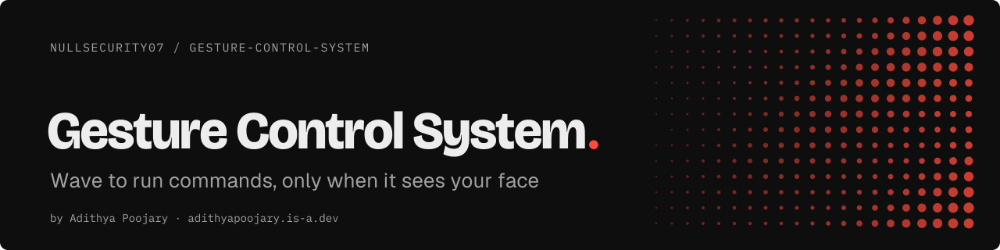
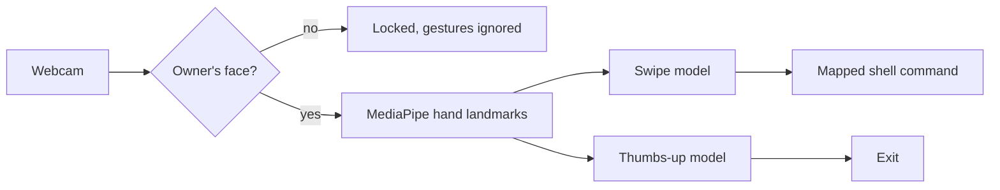

<p align="center"><a href="https://adithyapoojary.is-a.dev"><picture><source media="(prefers-color-scheme: light)" srcset=".github/readme/banner-light.svg"></picture></a></p>
<p align="center"><picture><source media="(prefers-color-scheme: light)" srcset=".github/readme/badges-light.svg"></picture></p>

Gesture Control turns hand gestures into shell commands, but only while the camera sees its owner's face. A hands-free desktop controller for Linux, with a face check standing between a wave and your terminal.

## Highlights

- **Face first.** Every 10 frames the webcam checks for the owner's face against a reference photo. No match, no commands.
- **Swipes switch workspaces.** A swipe left or right runs any shell command you map in `config.py`. Out of the box it moves between Hyprland workspaces.
- **Thumbs up to quit.** A static gesture, held steady over a 20-frame buffer, closes the controller.
- **Trained on your hands.** Collection scripts record your own gestures, and scikit-learn trains the models: a HOG + SVM classifier for the thumbs up and a Random Forest over 15-frame landmark sequences for swipes.
- **Cooldowns built in.** Each action waits before the next one fires, and a desktop notification says what just ran.

## How it works



1. `face_recognition` (dlib) compares the live face to `me.jpg`.
2. While the owner is in frame, MediaPipe tracks one hand.
3. The swipe model reads the last 15 frames of wrist and fingertip positions; the static model reads a HOG crop of the hand.
4. A recognised gesture runs its command from `ACTIONS` in `config.py`.

## Quick start

Linux with a webcam. Python 3.11 or 3.12 (pinned MediaPipe and SciPy versions need both bounds). dlib builds from source, so install CMake and a C++ compiler first.

```bash
git clone https://github.com/NullSecurity07/Gesture-Control-System.git
cd Gesture-Control-System
python -m venv venv_mp && source venv_mp/bin/activate
pip install -r requirements.txt
```

1. Put a clear photo of your face in the repo root as `me.jpg`.
2. Map gestures to commands in `config.py` (`ACTIONS`). The defaults call `hyprctl`.
3. Record your own thumbs-up and background images with `python collect_data.py` (the repo ships no photos), then train: `python train.py`.
4. Record and train swipes: `pip install cvzone`, then `python collect_swipes_cvzone.py` and `python train_swipes.py`.
5. Run it: `./run.sh main.py`

## Status

Prototype, built and used on Hyprland. Known gaps: `collect_swipes.py` writes `swipe_data.csv` while the trainers read `swipe_data_cvzone.csv`, so use the cvzone collector for now; `cvzone` and `xgboost` (for `train_swipes_advanced.py`) are not in `requirements.txt` yet.

## Built by

Built by [Adithya Poojary](https://adithyapoojary.is-a.dev), founder of ThreatScope. [More projects](https://adithyapoojary.is-a.dev/work/) · [LinkedIn](https://www.linkedin.com/in/adithyapoojary/)
